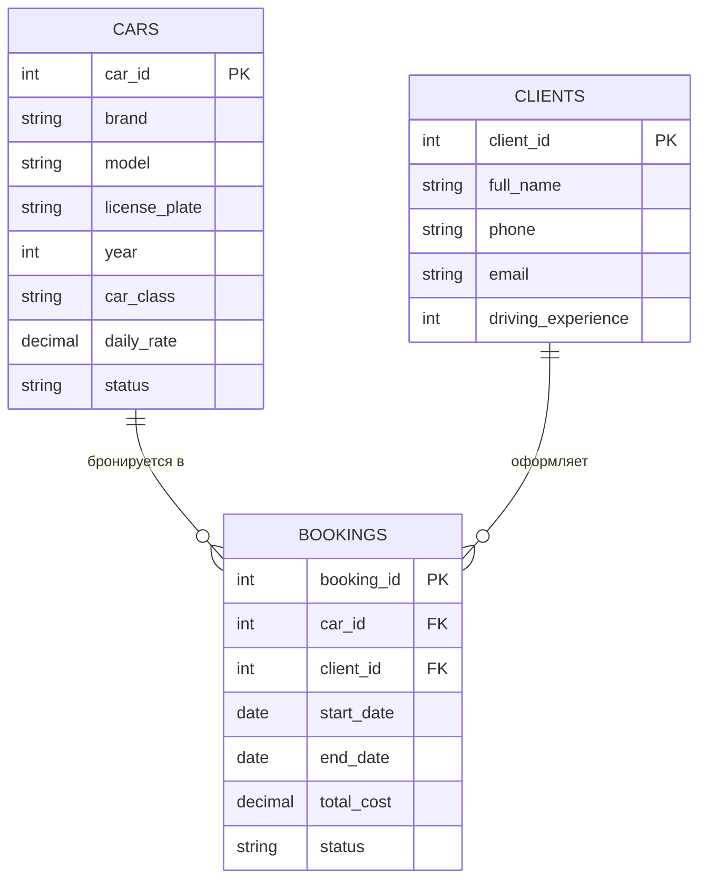

# Проектирование структуры базы данных «Прокат автомобилей»

## 1. ER-диаграмма данных (PlantUML)
Текстовый код для визуализации связей между таблицами базы данных.

## 2. Спецификация таблиц (Словарь данных)

### Таблица 1: `Cars` (Автомобили компании)
- `car_id` (Primary Key, INT): Уникальный номер автомобиля.
- `brand` (VARCHAR): Марка машины (например, Hyundai).
- `model` (VARCHAR): Модель машины (например, Solaris).
- `license_plate` (VARCHAR, Unique): Государственный регистрационный знак.
- `car_class` (VARCHAR): Класс комфорта (Эконом / Комфорт / Бизнес).
- `daily_rate` (DECIMAL): Стоимость аренды за одни сутки в рублях.
- `status` (VARCHAR): Текущее состояние (Доступен / В прокате / На ТО / В ремонте).

### Таблица 2: `Clients` (Зарегистрированные водители)
- `client_id` (Primary Key, INT): Уникальный номер клиента.
- `full_name` (VARCHAR): ФИО клиента.
- `phone` (VARCHAR): Контактный номер телефона.
- `email` (VARCHAR): Адрес электронной почты для уведомлений.
- `driving_experience` (INT): Стаж вождения в годах (для проверки ограничений).

### Таблица 3: `Bookings` (Заказы на аренду)
- `booking_id` (Primary Key, INT): Уникальный номер бронирования.
- `car_id` (Foreign Key, INT): Ссылка на арендованный автомобиль.
- `client_id` (Foreign Key, INT): Ссылка на клиента, оформившего заказ.
- `start_date` (DATE): Дата начала аренды.
- `end_date` (DATE): Дата окончания аренды.
- `total_cost` (DECIMAL): Автоматически рассчитанная полная стоимость проката.
- `status` (VARCHAR): Статус заказа (Новый / Подтвержден / Активен / Завершен / Отменен).
