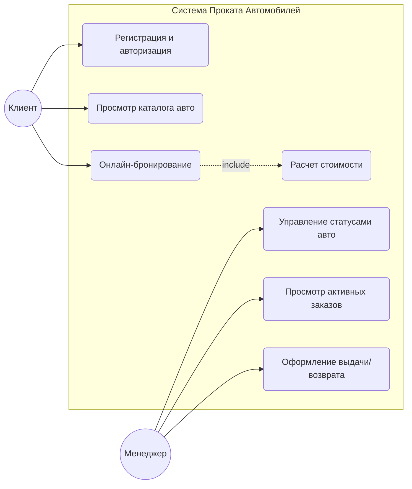

# Пользовательские сценарии (Use Cases) для системы «Прокат автомобилей»

## 1. Диаграмма прецедентов (PlantUML)
Ниже представлен текстовый код диаграммы Use Case. Расширение PlantUML в VS Code автоматически визуализирует её.

## 2. Спецификация основных сценариев

### Сценарий UC-01: Онлайн-бронирование автомобиля
- **Актёры:** Авторизованный клиент.
- **Предусловия:** Клиент вошел в свой личный кабинет, его водительский стаж проверен (более 2 лет).
- **Основной успешный сценарий:**
  1. Клиент открывает вкладку «Каталог автомобилей».
  2. Система отображает список доступных машин со статусом «Доступен».
  3. Клиент применяет фильтр по классу авто (например, «Комфорт») и выбирает конкретную модель.
  4. Клиент нажимает кнопку «Забронировать» и указывает даты в интерактивном календаре.
  5. Система автоматически рассчитывает стоимость аренды и выводит её на экран.
  6. Клиент подтверждает бронирование.
  7. Система меняет статус бронирования на «Подтверждено», блокирует авто на выбранные даты в календаре и отправляет email-уведомление клиенту.
- **Альтернативный сценарий (Даты заняты):** На шаге 4 выбранные даты пересекаются с чужой бронью. Система подсвечивает даты красным цветом, блокирует кнопку подтверждения и предлагает выбрать другой период.

### Сценарий UC-02: Оформление выдачи автомобиля в офисе
- **Актёры:** Менеджер по прокату, Клиент.
- **Предусловия:** Клиент прибыл в пункт выдачи, у него есть активное подтвержденное бронирование.
- **Основной успешный сценарий:**
  1. Менеджер открывает в админ-панели список активных заказов на текущие сутки.
  2. Находит бронь клиента по ФИО или номеру заказа.
  3. Менеджер сверяет оригиналы паспорта и водительского удостоверения с данными в системе.
  4. Система автоматически генерирует печатную форму договора аренды.
  5. Клиент подписывает договор и вносит залог наличными или картой через терминал.
  6. Менеджер отмечает в системе факт получения залога и нажимает кнопку «Выдать авто».
  7. Система меняет статус автомобиля на «В прокате», а статус заказа на «Активен».
- **Исключительный сценарий (Документы не совпали):** На шаге 3 данные документов в системе не совпадают с оригиналами. Менеджер аннулирует заказ в системе, статус брони меняется на «Отменено», машина возвращается в общий доступ каталога.
